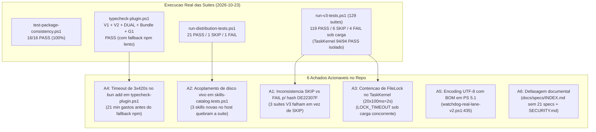

# Relatório de Auditoria Completa e Validação Empírica — `opencode-orchestration`

**Data da Auditoria:** 2026-10-23  
**Branch Auditada:** `feat/v2-native-first-refinement`  
**Preflight de Orquestração:** `PERSISTENT_GOAL` (`task_class: non_trivial`, compliance verificada)  
**Subagentes Executados (Modelo Flash):**
- `AUDIT-SOURCE-DOCS-01` — Auditoria de `source/`, `templates/`, `generated/`, `docs/` e `CHANGELOG.md` (`candidate_pass`)
- `AUDIT-SCRIPTS-RUNTIME-02` — Auditoria de `scripts/v3/`, `scripts/runtime/`, `scripts/ci/` e `plugins/` (`candidate_pass`)
- `AUDIT-EVIDENCE-TESTS-03` — Auditoria de `evidence/v3.1/`, `PAE-01..40`, `RR-E2E-01..41` e `tests/` (`candidate_pass`)

---

## 1. Resumo Executivo e Veredito Geral

O projeto `opencode-orchestration` apresenta **alta maturidade arquitetural**, separação rigorosa entre fonte canônica (`source/`), artefatos gerados (`generated/`) e destino ativo do usuário (`~/.config/opencode/`), além de contenção fail-closed real no kernel de tarefas, isolamento de worktrees/leases e supervisão de processos via Watchdog + Job Objects.

A validação empírica executada nesta auditoria rodou **todas as baterias oficiais do repositório** (16 checks de consistência, 3 trilhas de typecheck + bundle + testes Node do plugin, 23 suítes de distribuição e 129 suítes V3/V3.1). O cruzamento entre a inspeção estática dos 3 subagentes e a execução real revelou **6 achados acionáveis no repositório** (causas de falhas locais nas suítes, condição de corrida sob carga no lock do TaskKernel, lentidão de 21 min no typecheck do plugin no Windows e defasagem documental) e mapeou **5 residuais operacionais/upstream** que separam os itens em `HOLD`/`blocked` do fechamento runtime-real.

---

## 2. Resultado da Validação Empírica (Suítes Executadas)

| Bateria / Comando | Escopo Validado | Resultado Obtido | Tempo | Diagnóstico |
| :--- | :--- | :--- | :--- | :--- |
| [test-package-consistency.ps1](file:///D:/projetos/opencode-orchestration/scripts/test-package-consistency.ps1) | 16 invariantes estruturais (templates V1/V2, 19 agents, skills-core, plugin bundle `.sha256`, registries) | **16 / 16 PASS** | ~12s | 100% íntegro; paridade V1/V2 e hashes de `generated/manifest.json` exatos. |
| [typecheck-plugin.ps1](file:///D:/projetos/opencode-orchestration/scripts/ci/typecheck-plugin.ps1) | Typecheck estrito contra `@opencode-ai/plugin@1.18.34`, `@opencode/plugin@2.0.23`, dual, rebuild bundle e `node --test` de [index.tests.js](file:///D:/projetos/opencode-orchestration/plugins/g1-dispatch-admission/index.tests.js) | **PASS (exit 0)** | ~21m14s | Tipagem e bundle 100% limpos. Porém `bun add` sofreu timeout de 420s nas etapas `v2` e `dual` antes de cair no fallback `npm install`. |
| [run-distribution-tests.ps1](file:///D:/projetos/opencode-orchestration/tests/distribution/run-distribution-tests.ps1) | 23 suítes de instalação, idempotência, rollback, isolamento de perfil, tradução de permissões, MCP profiles e skills | **21 PASS / 1 SKIP / 1 FAIL** | ~6m33s | Única falha: [skills-catalog.tests.ps1](file:///D:/projetos/opencode-orchestration/tests/distribution/skills-catalog.tests.ps1#L139-L148) devido a 3 skills adicionadas no host (`find-skills`, `maestri-chat`, `cli-tooling`). |
| [run-v3-tests.ps1](file:///D:/projetos/opencode-orchestration/scripts/v3/run-v3-tests.ps1) | 129 suítes cobrindo Phases 0–42, Kernel, Watchdog, Job Objects, Worktree, Leases, Model Router vNext, Advisor, Drills F/G e Three-Phase Fixture | **119 PASS / 6 SKIP / 4 FAIL** *(120 PASS / 3 FAIL após re-run isolado)* | ~50m43s | 3 falhas são a invariante local `DE22307F` que deveria ser `[SKIP]` (como já é em outras 3 suítes); 1 falha foi `LOCK_TIMEOUT` transitório em [OrchestrationTaskKernel.tests.ps1](file:///D:/projetos/opencode-orchestration/scripts/v3/lib/OrchestrationTaskKernel.tests.ps1#L833) (passou **94/94** isolado em 36s). |

---

## 3. Auditoria de Arquitetura e Subsistemas (Nominal vs Real)

A auditoria de código em `scripts/v3/`, `scripts/runtime/`, `plugins/` e `source/registry/` confirma o estado real de cada recurso:

| Subsistema | Arquivos Principais | Estado Real | Avaliação Técnica |
| :--- | :--- | :--- | :--- |
| **Preflight & Gate de Orquestração** | [orchestration-preflight.ps1](file:///D:/projetos/opencode-orchestration/scripts/v3/orchestration-preflight.ps1), [OrchestrationPreflight.ps1](file:///D:/projetos/opencode-orchestration/scripts/v3/lib/OrchestrationPreflight.ps1) | **ATIVO / ENFORCED** | Classifica tarefas em `SINGLE_WORKER`, `MULTI_WORKER`, `PERSISTENT_GOAL`, `DETERMINISTIC_FALLBACK`, `BLOCKED` e `DIRECT_VERIFIED` (v0.2.0). Rejeita tokens legados fail-closed; exige `Test-OrchestrationDoneCompliance`. |
| **Task Kernel & Goal Kernel** | [task-kernel.ps1](file:///D:/projetos/opencode-orchestration/scripts/v3/task-kernel.ps1), [OrchestrationTaskKernel.ps1](file:///D:/projetos/opencode-orchestration/scripts/v3/lib/OrchestrationTaskKernel.ps1), [OrchestrationGoalKernel.ps1](file:///D:/projetos/opencode-orchestration/scripts/v3/lib/OrchestrationGoalKernel.ps1) | **ATIVO / ENFORCED** | Persistência atômica (`.tmp` + `Move` + verificação SHA256 pós-escrita), controle concorrente CAS (`ExpectedRevision`), bloqueio de autodeclaração de `DONE`/`verified_pass` por workers e exigência de `debugger` + evidência nova na 3ª tentativa. |
| **Runtime Watchdog + Job Objects** | [OrchestrationRuntimeWatchdog.ps1](file:///D:/projetos/opencode-orchestration/scripts/v3/lib/OrchestrationRuntimeWatchdog.ps1), [RuntimeJobObject.ps1](file:///D:/projetos/opencode-orchestration/scripts/runtime/lib/RuntimeJobObject.ps1) | **ATIVO / ENFORCED** | Flag `{enabled:true, shadow:false}`. Supervisiona `HARD_TIMEOUT`, `NO_PROGRESS`, `REPEATED_ACTION` e `REPEATED_CYCLE`. Só interrompe processos com identidade provada (`PID + CreationDate ticks UTC`). Anexa raiz verificada a Job Object (`KILL_ON_JOB_CLOSE`) antes do snapshot CIM e usa `TerminateJobObject` como backstop. |
| **Worktree Isolation & Write Leases** | [OrchestrationWorktree.ps1](file:///D:/projetos/opencode-orchestration/scripts/v3/lib/OrchestrationWorktree.ps1), [OrchestrationOwnership.ps1](file:///D:/projetos/opencode-orchestration/scripts/v3/lib/OrchestrationOwnership.ps1) | **ATIVO / ENFORCED** | Isolamento real em `cache/runtime/worktrees/<TASK_ID>`, proteção contra reparse points/junctions e detecção determinística de colisão de escopos de escrita (`Get-OrchestrationScopeOverlap`). |
| **Workflow Efficiency v0.2.0 & Model Router vNext** | [OrchestrationModelRouter.ps1](file:///D:/projetos/opencode-orchestration/scripts/v3/lib/OrchestrationModelRouter.ps1), [OrchestrationProportionalReuse.ps1](file:///D:/projetos/opencode-orchestration/scripts/v3/lib/OrchestrationProportionalReuse.ps1) | **ATIVO / ENFORCED** | Roteamento por tiers `T0..T4` (com gate financeiro fail-closed para `T4`), consulta estruturada ao `engineering-advisor` (`ConvertTo-StructuredAdvisoryOpinion`) e reuso proporcional baseado em `HEAD SHA` + hashes de arquivos em disco. |
| **Jev Advisory** | [OrchestrationJevAdvisory.ps1](file:///D:/projetos/opencode-orchestration/scripts/v3/lib/OrchestrationJevAdvisory.ps1), [jev-advisory-policy.json](file:///D:/projetos/opencode-orchestration/source/registry/jev-advisory-policy.json) | **ATIVO (Consultivo)** | Conectado ao loop do Planner (`P38-S2`) e com transporte HTTP real (`P29-S2`). Guard `Invoke-JevAdvisoryGrantGate` impede estruturalmente que o Jev altere rota, escopo ou aprove tarefas. |
| **AI Memory Remoto** | [OrchestrationAiMemoryRemote.ps1](file:///D:/projetos/opencode-orchestration/scripts/v3/lib/OrchestrationAiMemoryRemote.ps1), [ai-memory-remote-policy.json](file:///D:/projetos/opencode-orchestration/source/registry/ai-memory-remote-policy.json) | **ATIVO (User-Owned)** | Escopo explícito obrigatório (`workspace="ferramentas"`, `project="opencode-orchestration"`), `forbid_local_fallback: true` (nunca cai na porta local 49374) e transporte HTTPS/TLS 1.3 validado. |
| **Execution Budget (P23)** | [OrchestrationExecutionBudget.ps1](file:///D:/projetos/opencode-orchestration/scripts/v3/lib/OrchestrationExecutionBudget.ps1#L653-L662) | **HOLD HONESTO (`enforce=false`)** | Embora `bounded_execution.enabled = true`, `Get-ExecutionBudgetEnforcementState` retorna `enforce = $false` por construção (record-only). Os limites reais em operação vêm do Watchdog e do `AttemptBudget` do Kernel. |
| **Plugins V1/V2 & Grant Enforcement (Phase 5)** | [orchestration-enforcement.ts](file:///D:/projetos/opencode-orchestration/plugins/orchestration-enforcement.ts), [v1.ts](file:///D:/projetos/opencode-orchestration/plugins/orchestration-enforcement/v1.ts), [v2.ts](file:///D:/projetos/opencode-orchestration/plugins/orchestration-enforcement/v2.ts), [index.js](file:///D:/projetos/opencode-orchestration/plugins/g1-dispatch-admission/index.js) | **PARCIAL (Mandato + Telemetria ATIVOS; Grant Enforcement em HOLD OFF)** | O bundle dual-runtime injeta mandatos por papel e coleta telemetria (`event.subscribe` com `AbortController` anti-race no V2). O gate `g1-dispatch-admission` bloqueia subagents sem recibo assinado. Já `runtime_grant_enforcement.{v1,v2}` segue **OFF** porque a superfície `/shell` do OpenCode V2 `2.0.23` opera em *fail-open* para regras `deny`. |
| **Capability Router / Skill & MCP Routing** | [CapabilityRouter.ps1](file:///D:/projetos/opencode-orchestration/scripts/v3/lib/CapabilityRouter.ps1), [capability-flags.json](file:///D:/projetos/opencode-orchestration/source/registry/capability-flags.json) | **OFF POR DOUTRINA** | `capability_router`, `skill_routing`, `mcp_routing` e `adaptive_ranking` permanecem `false`; `route-accept.ps1` usa fallback determinístico. |
| **Wirings P31-S2, P38-S2-SPAWN, P40-S2, P41-S2** | [SessionBootstrapContext.ps1](file:///D:/projetos/opencode-orchestration/scripts/runtime/SessionBootstrapContext.ps1), [OrchestrationDispatchPipeline.ps1](file:///D:/projetos/opencode-orchestration/scripts/v3/lib/OrchestrationDispatchPipeline.ps1), [OrchestrationV2EvidenceSupersession.ps1](file:///D:/projetos/opencode-orchestration/scripts/v3/lib/OrchestrationV2EvidenceSupersession.ps1), [OrchestrationEvolutionTelemetryProducer.ps1](file:///D:/projetos/opencode-orchestration/scripts/v3/lib/OrchestrationEvolutionTelemetryProducer.ps1) | **CODE-COMPLETE / RECORD-ONLY** | Todos os 4 módulos estão implementados, revisados e provados em runtime (`wiring-runtime-2026-10-05/`), mas operam em modo `record-only` / `decision-record` até ativação explícita no ambiente de produção do operador. |

---

## 4. Diagnóstico Detalhado dos 6 Achados Acionáveis (Repositório)

### Achado A1 — Tratamento Inconsistente da Divergência Local `DE22307F` em 3 Suítes V3 (Severidade: Média / Qualidade de Teste)
- **Evidência:** Durante a execução de [run-v3-tests.ps1](file:///D:/projetos/opencode-orchestration/scripts/v3/run-v3-tests.ps1), 6 suítes inspecionam o arquivo `~/.config/opencode/opencode.json` vivo da máquina do operador procurando o prefixo de hash canônico `DE22307F` (atualmente o arquivo vivo possui hash `A863A942...` por customização local do usuário).
  - **3 suítes tratam como `[SKIP]` (exit 0):** [CapabilityActivation.tests.ps1](file:///D:/projetos/opencode-orchestration/scripts/v3/CapabilityActivation.tests.ps1), [CapabilityDeferred.tests.ps1](file:///D:/projetos/opencode-orchestration/scripts/v3/CapabilityDeferred.tests.ps1) e [skill-bridge.tests.ps1](file:///D:/projetos/opencode-orchestration/scripts/v3/skill-bridge.tests.ps1).
  - **3 suítes tratam como `[FAIL]` (exit 1):** [CapabilityObservability.tests.ps1](file:///D:/projetos/opencode-orchestration/scripts/v3/CapabilityObservability.tests.ps1), [CapabilitySkillUtility.tests.ps1](file:///D:/projetos/opencode-orchestration/scripts/v3/CapabilitySkillUtility.tests.ps1) e [shadow-route.tests.ps1](file:///D:/projetos/opencode-orchestration/scripts/v3/shadow-route.tests.ps1).
- **Impacto:** Derruba o resultado global de `run-v3-tests.ps1` na máquina do operador por um estado `user-owned` já documentado como não-bloqueante em [TROUBLESHOOTING.md](file:///D:/projetos/opencode-orchestration/docs/TROUBLESHOOTING.md), enquanto a invariante real (que os scripts CLI são read-only e não alteraram o `opencode.json` vivo antes/depois do teste) já é verificada separadamente.

### Achado A2 — Acoplamento ao Disco Vivo em `skills-catalog.tests.ps1` (Severidade: Média / Qualidade de Teste)
- **Evidência:** Em [skills-catalog.tests.ps1](file:///D:/projetos/opencode-orchestration/tests/distribution/skills-catalog.tests.ps1#L138-L149), após validar que `source/registry/skills-catalog.json` bate 100% com o inventário versionado (`evidence/capabilities-phase-2b/skills-inventory-2026-10-07.json`, `103 + 2 = 105`), o teste varre `~/.agents/skills` e `~/.config/opencode/skills` da máquina viva e exige `catalogo == disco (105)`. Como o host possui 3 skills novas (`find-skills`, `maestri-chat` e `cli-tooling`, total 108), a suíte falha com `3 FAIL`, apesar de `skills-healthcheck.ps1 -Json` retornar `verdict: PASS`.
- **Impacto:** Quebra `tests/distribution/run-distribution-tests.ps1` sempre que o usuário instala uma skill pessoal nova na máquina ou exige atualização do catálogo/inventário versionado.

### Achado A3 — Janela Curta de `Enter-TaskKernelFileLock` (`LOCK_TIMEOUT` sob Carga) (Severidade: Alta / Confiabilidade do Kernel)
- **Evidência:** No teste 31 (`concurrent same-revision transitions`) de [OrchestrationTaskKernel.tests.ps1](file:///D:/projetos/opencode-orchestration/scripts/v3/lib/OrchestrationTaskKernel.tests.ps1#L833), o bloco `[DIAG]` capturou durante a bateria completa:
  - `process_2` adquiriu o lock, executou a transição `DISCOVERING -> PLANNING` (revisão 2) e levou `7199ms` total sob carga de CPU/IO.
  - `process_1` falhou com `{ "ok": false, "error": "LOCK_TIMEOUT" }` (exit code `1` em `2900ms`) em vez de aguardar a liberação do lock e receber `CAS_CONFLICT` (exit code `3`).
- **Causa Raiz no Código:** Em [OrchestrationTaskKernel.ps1](file:///D:/projetos/opencode-orchestration/scripts/v3/lib/OrchestrationTaskKernel.ps1#L438-L450), `Enter-TaskKernelFileLock` usa defaults `$Retries = 20, $DelayMs = 100` (apenas **2,0 segundos** de espera máxima). Dentro da seção crítica, o processo vencedor serializa JSON determinístico, grava arquivo `.tmp`, executa `Move-Item`, relê do disco, calcula SHA256 e faz `ConvertFrom-Json`. No Windows PowerShell 5.1 sob carga + antivírus (Windows Defender), a seção crítica pode durar >2s, fazendo o processo concorrente abortar por `LOCK_TIMEOUT` antes de chegar à checagem CAS.

### Achado A4 — Degradação de 21 Minutos em `typecheck-plugin.ps1` por Timeout de `bun add` no Windows (Severidade: Média / DX & CI)
- **Evidência:** Em [typecheck-plugin.ps1](file:///D:/projetos/opencode-orchestration/scripts/ci/typecheck-plugin.ps1), cada uma das 3 trilhas (`v1`, `v2`, `dual`) tenta `bun add` em diretório temporário com timeout de `420000ms` (7 minutos). No Windows, `bun add` trava na resolução/extração em `v2` e `dual`, consumindo **14 a 21 minutos** antes de acionar o fallback `npm install`, que conclui em poucos segundos.

### Achado A5 — Divergência de BOM UTF-8 entre PS 5.1 e PS 7 em `watchdog-real-lane-v2.ps1` (Severidade: Baixa / Compatibilidade PS 5.1)
- **Evidência:** Em [watchdog-real-lane-v2.ps1](file:///D:/projetos/opencode-orchestration/scripts/ci/watchdog-real-lane-v2.ps1#L435), a chamada `[IO.File]::WriteAllText($ReadyFile, ('ready ' + $PID))` usa a sobrecarga de 2 argumentos, que grava UTF-8 **com BOM** no Windows PowerShell 5.1 e **sem BOM** no PowerShell 7, destoando do padrão canônico `[Text.UTF8Encoding]::new($false)` usado no restante do código.

### Achado A6 — Defasagem Documental em `docs/specs/INDEX.md` e `SECURITY.md` (Severidade: Baixa / Governança Documental)
- **Evidência:**
  1. [docs/specs/INDEX.md](file:///D:/projetos/opencode-orchestration/docs/specs/INDEX.md) lista apenas 11 specs, omitindo **21 das 32 especificações** presentes em `docs/specs/` (incluindo `WORKFLOW-EFFICIENCY-v0.2.0-SPEC.md`, `UNIVERSAL-AUTONOMOUS-ORCHESTRATION-v0.1.0-SPEC.md`, `BACKLOG-CONSOLIDATION-NATIVE-FIRST-SPEC.md`, `MODEL-ROUTER-vNext-SPEC.md` e specs de benchmark).
  2. [SECURITY.md](file:///D:/projetos/opencode-orchestration/SECURITY.md#L10-L21) ainda menciona versões antigas (`1.18.32` e `2.0.18` em vez dos pins vigentes `1.18.34` e `2.0.23` de [runtime-versions.json](file:///D:/projetos/opencode-orchestration/source/registry/runtime-versions.json)) e a classe antiga `diagnostic` (substituída por `validator-shell` em 2026-10-20).

---

## 5. Mapeamento dos 5 Residuais Operacionais / Upstream (Fora do Escopo de Bug de Código)

Estes itens **não são defeitos da implementação local**, mas sim decisões formais de segurança, governança ou dependências externas devidamente registradas em [program-status.json](file:///D:/projetos/opencode-orchestration/evidence/v3.1/runtime-reliability/program-status.json) e [pae-traceability.json](file:///D:/projetos/opencode-orchestration/evidence/v3.1/runtime-reliability/pae-traceability.json):

1. **Superfície `/shell` Fail-Open no OpenCode V2 (`2.0.23`) (`RR-E2E-39` / `PAE-31` / `Phase 5`):**
   - Os probes reais ([v2-native-probes.json](file:///D:/projetos/opencode-orchestration/evidence/v3.1/runtime-reliability/session-lane-2026-10-20/v2-native-probes.json)) comprovaram que o binário `@opencode/cli@2.0.23` executa comandos na rota `/shell` mesmo com regras `deny` configuradas. Por segurança, `runtime_grant_enforcement.v2` **deve permanecer `false` (HOLD)** até correção upstream.
2. **Cenários Cross-Session Dependentes de Inferência de Modelo Pago (`RR-E2E-20`, `RR-E2E-21`, `RR-E2E-22`):**
   - As pernas kernel-side estão 100% provadas nos testes automatizados, mas a perna final de turno vivo do modelo substituto em `20`/`21` e fresh session V1 em `22` exige execução com provedor de LLM autenticado e com quota ativa.
3. **Ativação em Produção dos Wirings (`P31-S2`, `P38-S2-SPAWN`, `P40-S2`, `P41-S2`):**
   - Os componentes já possuem prova de execução real (`wiring-runtime-2026-10-05/`), aguardando decisão humana do operador para ligar no arranque/loop ativo.
4. **Decisões de Produto (`RR-E2E-32` e `RR-E2E-33`):**
   - `RR-E2E-32` permanece bloqueado por doutrina porque o Jev é estritamente `advisory-only` (não dispara rotas).
5. **Reconciliação do Destino Vivo do Usuário (`DE22307F`):**
   - O arquivo `~/.config/opencode/opencode.json` da máquina possui customizações locais do operador; sua reconciliação via `scripts/reconcile-opencode-config.ps1` é uma decisão explícita do operador.
