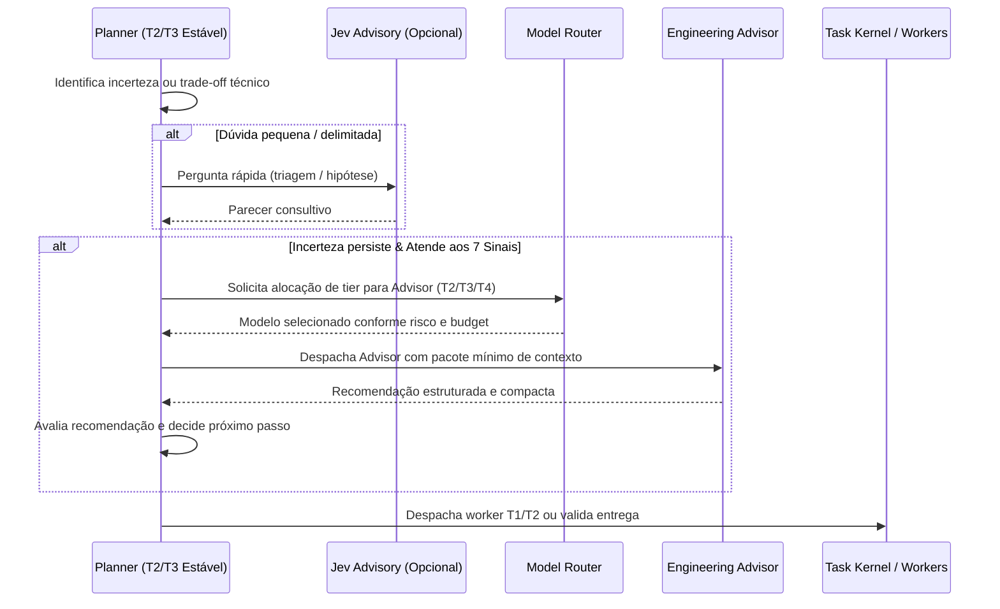

# ADR — Integração Jev & Advisor com Escalonamento Dinâmico de Modelos

**Status:** Aprovado  
**Data:** 2026-10-21  
**Decisores:** Antigravity / OpenCode Orchestration Team  
**Contexto Técnico:** Issues #60 (Engineering Advisor), #61 (Jev Decision Support), #99 (Model Router), #48 (Planejamento adaptativo)  

---

## 1. Contexto e Problema

O ecossistema de orquestração continha duas oportunidades críticas de melhoria:
1. **Integração Passiva do Jev:** Existiam duas vias de acesso ao Jev (MCP no host e transporte HTTP local no Kernel), mas a consulta no `OrchestrationPlannerLoop.ps1` ocorria sem que seu resultado modificasse as decisões de despacho ou alocação de agentes do plano.
2. **Planner com Alto Custo e Falta de Especialista Sob Demanda:** Manter modelos fortes (frontier) em tempo integral no Planner gera custo desproporcional de tokens. Por outro lado, a SPEC #99 proibia de forma rígida a utilização de modelos intermediários para papéis estratégicos e não oferecia um caminho flexível para consultar o `engineering-advisor` (Issue #60) com modelo ajustado à dificuldade real.

## 2. Decisão Arquitetural

Adota-se uma arquitetura de **Planner Econômico Estável com Advisor Inteligente Sob Demanda e Jev Consultivo**:

### 2.1 Papéis e Fronteiras de Responsabilidade

1. **Planner (`build`):** Opera em tier **T2 ou T3** estável (ex: modelos Flash / Sonnet econômicos). Não varia de modelo a cada turno nem roda em frontier o tempo todo. É o único detentor da autoridade sobre planejamento e despacho.
2. **Jev Decision Support (Issue #61):** Consultoria rápida, pontual e de baixíssimo custo para decisões delimitadas (ex: triagem de alternativas, estimativa de paralelismo, verificação prévia de suficiência). Nunca seleciona modelos nem autoriza ações.
3. **Advisor (`engineering-advisor`, Issue #60):** Especialista em raciocínio analítico profundo, ativado apenas quando necessário. Pode ser instanciado em **T2, T3 ou T4** pelo Model Router, conforme a gravidade do problema.
4. **Model Router (Issue #99):** Seleciona o tier de modelo adequado para os workers e para o Advisor, respeitando permissões, histórico e cotas de orçamento.

### 2.2 Fluxo Decisório Integrado

### 2.3 Regras de Não-Duplicação e Limites

- **Sem Consulta Redundante:** Se o Jev responder à dúvida satisfatoriamente, o Advisor **não** é chamado. Se o Advisor for chamado, não se re-consulta o Jev sobre a mesma questão.
- **Sem Loops de Delegação:** O Advisor não pode iniciar outro Planner, criar objetivos secundários ou acionar outro Advisor recursivamente.
- **Cota por Objetivo:** Máximo de 2 consultas ao Advisor por objetivo, com registro separado de custos.
- **Continuidade do Planner:** O parecer do Advisor é assimilado como dado em checkpoint compacto; o Planner não reinicia nem reconstrói seu contexto do zero.

### 2.4 Telemetria Obrigatória

Todas as consultas a Jev e Advisor registram telemetria estruturada contendo:
- `triggered`: booleano indicando se a condição de disparo ocorreu.
- `consulted`: booleano indicando se a chamada externa foi executada.
- `skipped`: booleano com motivo de descarte (`reuse-found`, `below-threshold`, `budget-exhausted`).
- `advice_used`: booleano indicando se o parecer influenciou a ação subsequente.
- `latency_ms`: tempo de resposta da consulta.
- `cost_tokens`: contagem de tokens consumidos na interação.

---

## 3. Consequências

- **Otimização Extrema de Custos:** 90% do tempo de execução transcorre em modelos econômicos (T2/T3), reservando o custo de raciocínio profundo (T4) exclusivamente para impasses reais.
- **Maior Precisão Técnica:** Decisões arquiteturais difíceis recebem análise de especialistas de alta capacidade sob demanda.
- **Governança Estrita:** Orçamentos e permissões permanecem sob controle do Kernel, impedindo execuções runaway.
