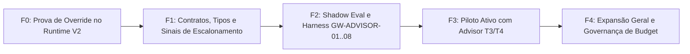

# PLAN — Model Router vNext & Intelligent Advisor Escalation

> **HEADER NORMATIVO: COMPANION PLAN PARA `MODEL-ROUTER-vNext-SPEC.md`.**
> Define a execução faseada do Model Router, integração do `engineering-advisor` (Issue #60), governança de custos e suites Golden Workflows GW-ADVISOR-01 a GW-ADVISOR-08.
> V2-only (OpenCode 2.0.23 baseline / 2.1.2 host). V1 é `LEGACY_FROZEN`.

---

## 1. Fases de Implementação

### Fase F0 — Prova de Capacidade de Override no Runtime V2
- **Objetivo:** Determinar formalmente se a ferramenta nativa `subagent` do binário OpenCode V2 aceita seleção de modelo por chamada individual.
- **Passos:**
  1. Executar probe direcionado no runtime V2 pinado (2.0.23) e no host ativo (2.1.2).
  2. Testar despacho com argumento de modelo e verificar logs de processo / recibos de sessão.
  3. Registrar veredito irrevogável: `PROOF_VERIFIED` ou `PROOF_ABSENT`.
- **Comportamento em `PROOF_ABSENT`:** Ativar a alternativa segura descrita na SPEC §7 (roteamento via alocação de papéis em slots `models.jsonc` e seleção de modo de execução, sem tentar monkey-patching).

### Fase F1 — Contratos Tipados e Sinais de Escalonamento
- **Objetivo:** Implementar as estruturas de dados e validadores dos contratos de roteamento e consulta ao Advisor.
- **Entregáveis:**
  1. Biblioteca de tipos e validação de requisições (`AdvisorConsultationRequest` / `AdvisorConsultationResponse`).
  2. Implementação do avaliador dos 7 Sinais de Escalonamento no `OrchestrationPlannerLoop.ps1`.
  3. Suíte de testes unitários para a matriz de admissibilidade e validação de tiers T0..T4.

### Fase F2 — Avaliação Shadow e Harness dos Golden Workflows
- **Objetivo:** Executar o pipeline com cálculo de tiers e telemetria de Advisor em modo shadow (sem alterar o despacho de produção) e montar os 8 Golden Workflows.
- **Suíte de Testes (Golden Workflows):**
  - `GW-ADVISOR-01`: Tarefa simples resolvida via `DIRECT_VERIFIED` com zero sobrecarga de subagent.
  - `GW-ADVISOR-02`: Impasse técnico que aciona `engineering-advisor` em tier T3 e gera recomendação conclusiva.
  - `GW-ADVISOR-03`: Escalonamento para T4 após comprovação de falha e necessidade crítica de raciocínio.
  - `GW-ADVISOR-04`: Reuso de recomendação validada anterior por hash de contexto.
  - `GW-ADVISOR-05`: Jev respondendo decisão delimitada e evitando consulta de Advisor.
  - `GW-ADVISOR-06`: Fallback gracioso com Advisor indisponível, impedindo loop e falso DONE.
  - `GW-ADVISOR-07`: Continuidade do Planner com assimilação do parecer em checkpoint compacto.
  - `GW-ADVISOR-08`: Encadeamento de limites de orçamento impedindo chamadas pagas desautorizadas.

### Fase F3 — Piloto Ativo Controlado
- **Objetivo:** Habilitar em produção delimitada o escalonamento para `engineering-advisor` em classes de tarefas selecionadas (`debugging`, `architecture`, `concurrency`).
- **Critérios de Promoção:**
  - Redução de pelo menos 25% no `cost-to-DONE` em comparação ao baseline com modelos estáticos.
  - Taxa de sucesso verificado em primeira tentativa do Advisor ≥ 80%.
  - Zero loops de consulta e zero bypass de permissões.

### Fase F4 — Expansão Geral e Governança Orçamentária
- **Objetivo:** Generalização da matriz de tiers T0..T4 para todos os workers e agentes operacionais, com controle orçamentário em USD/tokens por objetivo.

---

## 2. Estratégia de Rollout e Rollback

### Rollout Incremental
1. **Ativação por Flag de Rollout:** O roteamento de modelo e Advisor nascem desligados por default (`source/registry/capability-flags.json: model_routing.active = false`).
2. **Degradação Automática:** Qualquer exceção, timeout ou incerteza no router degrada imediatamente para o modelo padrão (baseline estático `models.jsonc`), sem falhar a tarefa do usuário.
3. **Cota de Segurança:** Máximo de 2 consultas ao Advisor por objetivo de desenvolvimento e teto financeiro pré-estabelecido.

### Rollback Imediato
- Se houver divergência de conformidade no Kernel, erro de parse no parecer do Advisor ou aumento inesperado de custo:
  1. Desligar a flag `model_routing.active = false` (reversão instantânea ao baseline estável de 3 slots).
  2. Registrar relatório de auditoria em `evidence/v3.1/runtime-reliability/model-router-rollback.json`.
