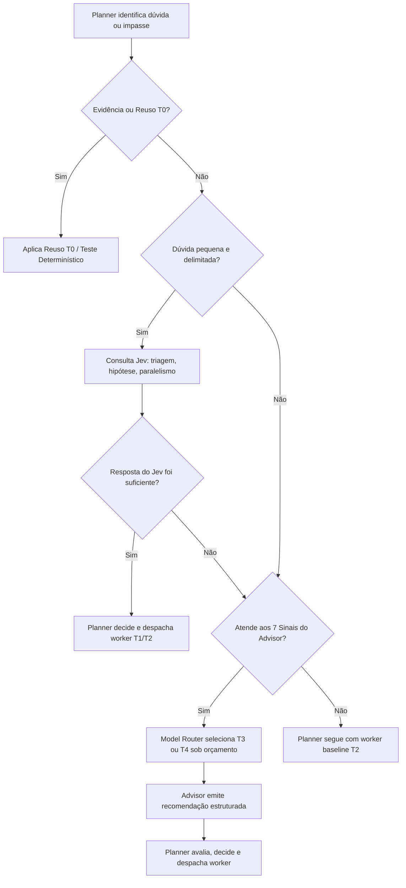

# SPEC — Model Router vNext & Intelligent Advisor Escalation

> **HEADER NORMATIVO: V2-ONLY, V1 `LEGACY_FROZEN`.**
> Este documento especifica o roteamento dinâmico de modelos por tarefa e risco (Issue #99), o Planner Econômico Estável, a integração do Advisor Especializado sob demanda (`engineering-advisor`, Issue #60) e o suporte consultivo do Jev (Issue #61).
> Substitui a rigidez estática anterior por uma matriz de admissibilidade orientada a risco e valor comprovado.
> Preserva Task Kernel, autoridade do Planner, governança de segurança e DONE gates.

**Issues relacionadas:** #99 (Model Router), #60 (Advisor / Impasses), #61 (Jev Decision Support), #30 (Golden Workflows), #48 (Planejamento adaptativo), #102 (Modelos/Custos).
**Change class:** `FEATURE_REEVALUATION` + `WORKFLOW_EFFICIENCY`
**Escopo de runtime:** V2-only (OpenCode 2.0.23 baseline / 2.1.2 host). V1 é `LEGACY_FROZEN`.
**Companion PLAN:** `MODEL-ROUTER-vNext-PLAN.md`

---

## 1. Visão Geral e Arquitetura

O objetivo central é reduzir custos, desperdício de tokens e complexidade desnecessária de agentes, preservando qualidade e autonomia.

### 1.1 Topologia Arquitetural

O Planner principal opera em modelo estável, econômico e capaz (T2/T3). Não executa modelo frontier em tempo integral nem alterna de modelo a cada turno ou wave. Quando se depara com impasses de raciocínio, diagnósticos complexos ou decisões arquiteturais críticas, consulta um **subagent Advisor especializado** (`engineering-advisor`), cujo modelo é selecionado dinamicamente pelo Model Router entre T2, T3 ou T4:

```text
PLANNER (T2/T3 — modelo estável, econômico e capaz)
    │
    ├── Preflight / Reuse / Workflow Optimizer
    │      ├── DIRECT_VERIFIED (tarefas triviais locais, sem subagent)
    │      ├── DETERMINISTIC_EXECUTION (scripts/testes com exit code)
    │      └── REUSE_VERIFIED (evidência idêntica confirmada)
    │
    ├── Model Router (seleção dinâmica de tiers por tarefa e risco)
    │      ├── Workers T1 / T2 (execução econômica padrão)
    │      ├── Workers T3 / T4 (quando a complexidade exigir)
    │      └── Advisor T3 / T4 (sob demanda, perguntas delimitadas)
    │
    ├── Jev Decision Support (opcional, decisões delimitadas/consultivas)
    │
    └── Task/Goal Kernel (autoridade canônica de grants, leases, validação e DONE)
```

### 1.2 Princípios de Autoridade e Continuidade

1. **Planner (`build`):** Conserva total autoridade sobre planejamento, delegação, continuação e aceitação. O Planner não transfere autoridade executiva para o Advisor nem para o Jev.
2. **Advisor (`engineering-advisor`):** Raciocínio sob demanda. Não assume controle do objetivo, não gera novos Planners nem encadeia chamadas recursivas a outros Advisors.
3. **Model Router:** Seleciona operacionalmente o tier/modelo adequado para workers e Advisor, conforme limites de cota, orçamento e permissões.
4. **Kernel:** Autoridade inviolável sobre transições, grants e emissão de `DONE`. Recomendações de modelos ou pareceres do Advisor são insumos, nunca prova de conclusão.

---

## 2. Taxonomia de Tiers de Modelo

A seleção de modelo desassocia-se do cargo estático do agente e passa a depender da classe da tarefa, risco e comprovação de qualidade:

| Tier | Categoria | Perfil Típico de Modelo | Casos de Uso Apropriados | Custo Relativo |
|---|---|---|---|---|
| **T0** | Determinístico / Reuso | N/A (Scripts, AST, ArtifactRef, Cache) | Execução de comandos determinísticos, verificação de hashes, reuso exato | Zero tokens |
| **T1** | Gratuito / Ultraleve | Modelos gratuitos, locais ou micro (ex: Jev Free, SLMs) | Consultas classificatórias, triagem inicial, extração simples de tokens | Gratuito / Mínimo |
| **T2** | Econômico / Flash | Gemini 1.5 Flash, Claude 3.5 Haiku, DeepSeek V4.1 Flash, GPT-4o-mini | Coder padrão, análises rotineiras, reviews de baixo risco, Advisor técnico simples | $ (0.1x baseline) |
| **T3** | Intermediário / Capaz | Claude 3.5 Sonnet, GPT-4o, Gemini 1.5 Pro | Refatorações multi-arquivo, debugging de média complexidade, Advisor arquitetural | $$ (1.0x baseline) |
| **T4** | Strong / Frontier | Modelos de raciocínio profundo (O1, O3, Claude Opus) | Impasses reais pós-falha, decisões irreversíveis/segurança crítica, Advisor T4 | $$$$ (5x–15x) |

---

## 3. Matriz de Admissibilidade por Agente, Classe e Risco

A proibição anterior da SPEC #99 que impedia agentes como Reviewer, Debugger, Architect e Security Reviewer de utilizarem tiers econômicos é substituída pela matriz de admissibilidade baseada no risco efetivo da tarefa:

| Agente | Tier Padrão | Tiers Admissíveis | Condições de Escalonamento / Redução | Proibições Estritas |
|---|---|---|---|---|
| **`build` (Planner)** | **T2/T3** | T2, T3 | Fixo durante o objetivo normal. Sem rotação a cada wave. | T4 contínuo; rotação randômica |
| **`engineering-advisor`** | **T3** | T2, T3, T4 | T2 para dúvidas simples; T3 diagnóstico/design; T4 impasse real | Loops recursivos de Advisors |
| **`coder`** | **T2** | T1, T2, T3, T4 | T2 default; T3 refatoração complexa; T4 após falha comprovada + Debugger | T4 sem falha prévia comprovada |
| **`explorer`** | **T1/T2** | T0, T1, T2 | T0 reuso; T1/T2 busca e leitura de repositório | T3/T4 (leitura não justifica frontier) |
| **`researcher`** | **T2** | T1, T2, T3 | T2 default; T3 síntese comparativa de alta incerteza | T4 desnecessário |
| **`tester`** | **T0/T2** | T0, T1, T2 | T0 para suítes existentes (exit code); T2 geração de testes | T3/T4 para rodar testes |
| **`reviewer`** | **T2/T3** | T2, T3, T4 | T2 para low-risk/cosmetic/docs; T3 normal (L2); T4 critical/cross-cutting | T2 para mudanças HIGH/CRITICAL |
| **`debugger`** | **T3** | T2, T3, T4 | T2 para sintaxe/typos; T3 para falhas de lógica; T4 bugs não reproduzíveis | T4 para bug com stacktrace óbvio |
| **`security-reviewer`**| **T3** | T3, T4 | T3 normal; T4 auth, cripto, permissões, produção, credentials | T1/T2 para validação de segurança |
| **`architect`** | **T3** | T3, T4 | T3 para design modular; T4 para consenso/protocolo distribuído | T1/T2 para decisões irreversíveis |
| **`docs-manager`** | **T1/T2** | T0, T1, T2 | T0 reuso; T1/T2 documentação interna | T3/T4 para markdown rotineiro |
| **`frontend-engineer`**| **T2** | T1, T2, T3 | T2 layout e componentes; T3 estados assíncronos complexos | T4 sem aprovação de custo |
| **`backend-engineer`** | **T2** | T2, T3, T4 | T2 endpoints padrão; T3 concorrência; T4 segurança de transação | T4 para CRUD comum |
| **`database-engineer`**| **T2** | T2, T3, T4 | T2 queries rotineiras; T3 schema; T4 migrações HIGH/CRITICAL | T1/T2 em migração destrutiva |
| **`infra-engineer`** | **T0/T2** | T0, T2, T3 | T0 scripts determinísticos; T2 pipelines; T3 infra mutável | T4 para rodar script existente |

---

## 4. Política de Escalonamento: Sinais Concretos para Consulta ao Advisor

O Planner deve acionar o `engineering-advisor` **somente** diante de sinais objetivos, evitando overhead em tarefas simples:

### 4.1 Os 7 Sinais Concretos de Acionamento

1. **Alternativas Técnicas com Trade-offs Divergentes:** O Planner identifica ≥ 2 caminhos de implementação com consequências estruturais ou operacionais significativamente diferentes.
2. **Falha de Worker sem Informação Nova:** Um worker falhou e repetir a mesma abordagem com o mesmo modelo não trará novos dados ou aprendizado.
3. **Evidências Contraditórias:** Diagnósticos, logs ou saídas de testes apresentam resultados inconsistentes que impedem uma decisão segura.
4. **Capacidade Cognitiva Insuficiente:** A complexidade da abstração ou lógica requer raciocínio conceitual além da capacidade demonstrada do modelo T2 atual.
5. **Decisão Arquitetural Multi-componente:** A alteração impacta múltiplos domínios ou viola fronteiras estabelecidas de módulos.
6. **Impasse Técnico Real:** Após investigação de contexto, ferramentas e documentação, a causa raiz permanece oculta.
7. **Risco Econômico Desproporcional:** O custo esperado de uma decisão errada (re-trabalho, falha em CI, rollback) supera nitidamente o custo da consulta ao Advisor ($0.02 a $0.15).

> [!IMPORTANT]
> **Anti-padrão Proibido:** Nunca acionar o Advisor apenas porque a tarefa foi classificada como `complex`. Sempre verificar primeiro se não falta informação, ferramenta ou contexto que possa ser recuperado por T0/T2 antes de escalar modelo.

---

## 5. Contrato de Consulta ao Advisor

A consulta do Planner ao Advisor utiliza pacote de contexto mínimo e estruturado, evitando despejo descontrolado de histórico de chat.

### 5.1 Request: `AdvisorConsultationRequest`

```json
{
  "consultation_id": "ADV-REQ-20261021-001",
  "task_id": "T-146-CONCURRENCY-FIX",
  "objective": "Prevenir corrupção em escritas assíncronas concorrentes de workers",
  "trigger_signal": "CONTRADICTORY_EVIDENCE",
  "specific_problem": "FileShare.None bloqueia colisões mas lança IOException não tratada na camada superior",
  "relevant_evidence_refs": [
    "evidence/v3.1/runtime-reliability/v2-regression-gate-result.json"
  ],
  "prior_attempts": [
    { "attempt": 1, "tier": "T2", "outcome": "IOException não capturada" }
  ],
  "constraints": [
    "PowerShell 5.1 e 7 compatível",
    "Sem loop infinito",
    "Fail-closed"
  ],
  "known_alternatives": [
    "A: Exponential bounded backoff com jitter",
    "B: Named Mutex global cross-process"
  ]
}
```

### 5.2 Response: `AdvisorConsultationResponse`

```json
{
  "consultation_id": "ADV-REQ-20261021-001",
  "advisor_model_tier": "T3",
  "advisor_model_effective": "claude-3-5-sonnet",
  "recommendation": "Adotar alternativa A (Exponential bounded backoff com max 5 tentativas e ceiling 15000ms), pois Named Mutex possui semântica de abandono complexa em falhas de processo no Windows",
  "short_technical_rationale": "Named Mutex pode causar AbandonedMutexException e deadlocks órfãos; backoff com FileShare.None é auto-recuperável e atômico",
  "confidence": 0.92,
  "actionable_next_step": {
    "action": "DISPATCH_WORKER",
    "target_agent": "coder",
    "suggested_tier": "T2",
    "scope": "scripts/v3/lib/OrchestrationConcurrency.ps1"
  },
  "risks": [
    "Latência de pico pode atingir 15s em contenção severa"
  ],
  "verification_steps": [
    "powershell -NoProfile -File scripts/v3/opencode-v2-regression-gate.tests.ps1"
  ],
  "needs_more_information": false
}
```

---

## 6. Integração Tríplice: Jev + Advisor + Model Router

Os três módulos operam de forma orquestrada e complementar:



1. **Jev:** Decisões rápidas e pequenas (triagem, comparar 2 opções, avaliar necessidade de paralelismo). Custo quase zero. Se o Jev resolver a incerteza, **não** consulta o Advisor.
2. **Model Router:** Decide se a consulta ao Advisor usará T3 ou T4 com base no risco e no orçamento disponível.
3. **Advisor:** Raciocínio técnico profundo somente quando o Jev não for suficiente e houver impasse real comprovado.

---

## 7. Verificação de Suporte no Runtime V2 e Salvaguarda `PROOF_ABSENT`

Antes de assumir que o runtime V2 aceita seleção de modelo por chamada da ferramenta `subagent`:

1. **Verificação Técnica no Binário Pinado:** Sonda direta no runtime V2 para verificar se o parâmetro `model` é aceito pela tool nativa `subagent` da sessão.
2. **Registro Fail-Closed:** Se a capacidade não for comprovada no binário em uso, o sistema registra `PROOF_ABSENT`.
3. **Alternativa Segura sem Executor Paralelo:** Na ausência de suporte nativo a override dinâmico na tool `subagent`, o Model Router opera em **nível de estratégia e agente**:
   - Ajusta o agente despachado (ex: `coder` em cheap vs `architect` / `engineering-advisor` configurados no slot correspondente em `models.jsonc`).
   - Modula o fan-out e a estratégia (execução direta `DIRECT_VERIFIED`, reuso `REUSE_VERIFIED` ou validação determinística).
   - Não cria executores paralelos inseguros fora dos padrões do OpenCode.

---

## 8. Golden Workflows de Validação (GW-ADVISOR-01 a GW-ADVISOR-08)

Os cenários de teste end-to-end do fluxo Advisor + Model Router:

- **GW-ADVISOR-01 (Tarefa Simples):** Planner econômico resolve fix cosmético via `DIRECT_VERIFIED` ou despacha `coder` T2 sem acionar Advisor nem Jev.
- **GW-ADVISOR-02 (Problema Difícil):** Planner encontra impasse de concorrência, consulta Advisor T3, recebe recomendação de backoff e executa com sucesso.
- **GW-ADVISOR-03 (Escalonamento T4):** Advisor T3 declara incerteza em decisão de segurança crítica; Model Router escala para T4 autorizado; recomendação previne vulnerabilidade.
- **GW-ADVISOR-04 (Reuso de Parecer):** Problema similar recorrente reutiliza `AdvisorConsultationResponse` válida anterior sem disparar nova chamada de LLM.
- **GW-ADVISOR-05 (Jev Eficiente):** Decisão delimitada de ordenação de testes é respondida pelo Jev com economia de 100% em relação a uma consulta de Advisor.
- **GW-ADVISOR-06 (Fallback por Indisponibilidade):** Advisor ou provider fora do ar retorna fallback estruturado; Planner prossegue sem loops nem falso DONE.
- **GW-ADVISOR-07 (Continuidade de Contexto):** Planner recebe parecer do Advisor e continua o objetivo sem recriar histórico nem reprocessar documentos prévios.
- **GW-ADVISOR-08 (Governança de Budget):** Consultas ao Advisor são contabilizadas; atingido o teto orçamentário, novas consultas pagas são bloqueadas e o sistema degrada graciosamente ao baseline.

---

## 9. Métricas Obrigatórias e Critérios de Conclusão

O sucesso do programa é medido pelas seguintes métricas agregadas:

1. **Custo do Planner vs Workers vs Advisor vs Jev:** Decomposição transparente dos tokens e custos em USD de cada participante.
2. **Tokens Evitados por Reuso e Rota Direta:** Economia gerada por `DIRECT_VERIFIED` e cache de evidências.
3. **Taxa de Resolução na Primeira Tentativa do Advisor:** ≥ 80% das consultas resultando em ação aprovada na etapa seguinte.
4. **Custo Total até DONE (Cost-to-DONE):** Redução mínima mensurada de 30% a 50% em relação ao baseline de subagents indiscriminados com modelos estáticos.
5. **Zero Regressão de Segurança e Autoridade:** Nenhuma concessão indevida de permissões, nenhum bypass de branches protegidas e 100% de conformidade com os testes de Task Kernel.
