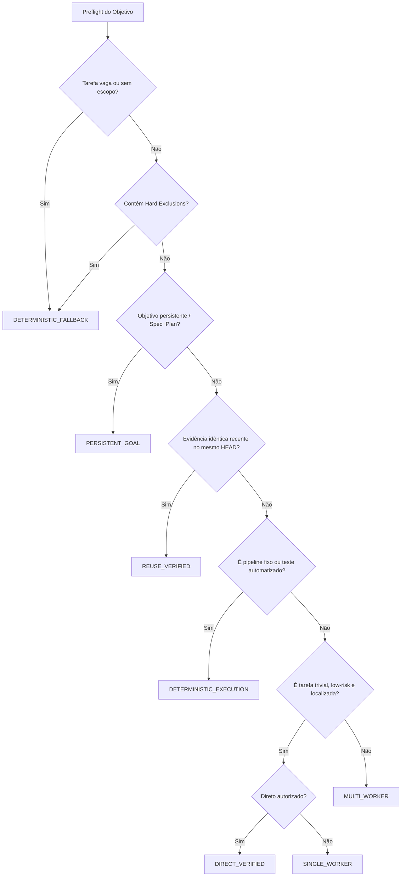

# SPEC — Workflow Efficiency & Adaptive Model Routing (v0.2.0)

> **HEADER NORMATIVO: ESCOPO OPENCODE V2, V1 `LEGACY_FROZEN`.**
> Este documento estabelece a especificação canônica de eficiência de workflows, roteamento adaptativo de modelos, execução direta proporcional e governança de custos do OpenCode Orchestration v0.2.0.
> Consolida as decisões das Issues #4, #11, #12, #14, #15, #17, #19, #30, #48, #60, #61, #77, #99, #102, #105, #106, #116, #137, #138 e #146.

**Status:** Aprovado  
**Baseline:** `feat/v2-native-first-refinement` @ `857a65a` / OpenCode V2.0.23 (CI Pinned) / V2.1.2 (Host)  
**Authority Boundary:** Task Kernel (`scripts/v3/task-kernel.ps1`), Agent Config (`~/.config/opencode/`)  

---

## 1. Problema e Motivação

O ecossistema anterior impunha custos desproporcionais por três fatores fundamentais:
1. **Ritualismo Burocrático de Agentes:** A obrigatoriedade de despachar subagents até para tarefas triviais (como correções ortográficas ou inspeções simples) gerava desperdício contínuo de tokens e latência.
2. **Modelos Vinculados Estaticamente a Cargos:** Agentes como `reviewer`, `debugger`, `architect` e `security-reviewer` estavam amarrados a modelos caros de alta capacidade (`MODEL_STRONG`), mesmo quando atuavam em tarefas de escopo restrito ou baixo risco.
3. **Ausência de Reuso Sistemático e Decisões Desarticuladas:** Consultas a assessores (como Jev) ocorriam sem aproveitamento real no despacho, e evidências prévias válidas eram reexecutadas sem checagem de frescor.

---

## 2. Princípios Arquiteturais Canônicos

1. **Native-First:** Utilizar os recursos nativos do OpenCode V2 (sessões, ferramentas de subagent, CLI, permissões) antes de introduzir scripts ad-hoc.
2. **Reuse-First:** Buscar resultado exato em `ArtifactRef`, cache de evidência e hashes de commit antes de recalcular ou reexecutar suítes de testes.
3. **Quality-First com Eficiência Mensurada:** Economizar recursos sem reduzir a qualidade da entrega nem contornar os gates de segurança.
4. **Modelo por Tarefa, Não por Cargo:** O tier do modelo (T0..T4) é determinado pela classe da tarefa, incerteza e risco, e não pela nomenclatura do agente.
5. **Menor Número Útil de Subagents:** Preferir sempre a topologia mais simples capaz de atingir os critérios de aceite (Direto > 1 Worker > Multi-Worker).
6. **Verificação Proporcional ao Risco:** Adequar o rigor e os papéis de validação (L0 a L3) ao impacto real da alteração.
7. **Jev Consultivo e Seletivo:** Consultar o Jev apenas quando uma resposta delimitada puder reduzir incertezas ou evitar custos maiores.
8. **Planner Econômico Estável + Advisor Sob Demanda:** O Planner opera em modelo econômico (T2/T3) e recorre ao `engineering-advisor` apenas diante de impasses e decisões complexas.
9. **OpenCode V1 Congelado (`LEGACY_FROZEN`):** Nenhuma alteração retroativa ou quebra de paridade é permitida no runtime V1.

---

## 3. Seleção Dinâmica de Estratégias de Execução

O Preflight avalia o objetivo e seleciona deterministicamente a estratégia ótima:

### Definição das 6 Estratégias

1. **`DIRECT_VERIFIED`:**
   - *Aplicabilidade:* Tarefas triviais, correções de 1 linha, typos, formatações cosméticas, leituras pontuais.
   - *Execução:* O Planner executa diretamente no seu turno sem despachar subagents.
   - *Requisitos de DONE:* `ExecutionShape = DIRECT_VERIFIED`, `DirectReason = DIRECT_VERIFIED_*`, `ActualWorkerParticipation = 0`.
2. **`SINGLE_WORKER`:**
   - *Aplicabilidade:* Tarefas focadas que requerem autonomia de execução isolada através de 1 worker econômico (T2).
   - *Requisitos de DONE:* `ActualWorkerParticipation >= 1`.
3. **`MULTI_WORKER`:**
   - *Aplicabilidade:* Tarefas de engenharia padrão e de risco médio/alto, exigindo o ciclo `coder -> tester -> reviewer`.
   - *Requisitos de DONE:* Participação coordenada comprovada no Kernel.
4. **`PERSISTENT_GOAL`:**
   - *Aplicabilidade:* Metas multi-fase, épicos e implementações estruturais que exigem plano persistente.
5. **`REUSE_VERIFIED`:**
   - *Aplicabilidade:* Tarefas cujos inputs, arquivos e commit HEAD são idênticos a uma execução anterior validada e fresca.
   - *Execução:* Reutilização de `ArtifactRef` sem re-execução de modelos ou ferramentas pesadas.
6. **`DETERMINISTIC_EXECUTION`:**
   - *Aplicabilidade:* Execuções baseadas em ferramentas determinísticas com exit code (ex: `npm test`, linter, verificação de consistência).

---

## 4. Tiers de Modelos e Matriz de Admissibilidade

### 4.1 Tiers Funcionais

- **T0 (Determinístico / Reuso):** Scripts nativos, parsing de AST, cache de testes. Custo zero tokens.
- **T1 (Gratuito / Ultraleve):** Modelos free (ex: Jev Free, SLMs locais). Para classificação e triagem rápida.
- **T2 (Econômico / Flash):** Modelos de alta velocidade e baixo custo (Gemini 1.5 Flash, Claude 3.5 Haiku, DeepSeek V4.1 Flash, GPT-4o-mini). Padrão para Planner estável, coders rotineiros e leituras.
- **T3 (Intermediário / Capaz):** Modelos de raciocínio avançado (Claude 3.5 Sonnet, GPT-4o). Para diagnósticos complexos, refatorações multi-arquivo e Advisor arquitetural.
- **T4 (Strong / Frontier):** Modelos de raciocínio profundo frontier (O1, O3, Opus). Exclusivo para impasses técnicos reais pós-falha e decisões críticas de segurança.

### 4.2 Admissibilidade por Agente

Todo agente pode operar em diferentes tiers conforme o risco da tarefa, eliminando a exclusividade cega de modelos fortes:
- `reviewer`: T2 para tarefas de risco baixo; T3 para validação normal (L2); T4 para mudanças críticas (L3).
- `debugger`: T2 para sintaxe e typos; T3 para bugs lógicos comuns; T4 para impasses não reproduzíveis.
- `security-reviewer`: T3 padrão; T4 para mutações de auth/produção/permissões.
- `engineering-advisor`: T2 para consultas técnicas básicas; T3 para diagnósticos estruturais; T4 para impasses críticos comprovados.

---

## 5. Salvaguarda `PROOF_ABSENT` para Roteamento Nativo V2

Diante da ausência de suporte comprovado a override dinâmico de modelo na chamada da tool `subagent` no binário OpenCode V2:
1. O sistema opera registrando o status de capacidade como `PROOF_ABSENT`.
2. O roteamento de modelo opera no **nível de seleção de agente e modo de workflow**:
   - Ajusta o papel despachado para corresponder ao slot estático pré-configurado no host (`models.jsonc`).
   - Modula o pipeline de agentes (reduzindo fan-out de 3 agentes para execução direta quando seguro).
   - Não implementa hooks não autorizados nem tenta sobrescrever binários em tempo de execução.

---

## 6. Governança e Garantias de DONE

1. **Evidence Freshness Integrada:** Todo `DONE` que envolva evidências anexadas passa pelo validador `Test-OrchestrationDoneAllowedByEvidence`. Evidências com campos ausentes (`head_sha`, `timestamp`), idade expirada ou commit divergente são bloqueadas fail-closed com `EVIDENCE_STALE_BLOCKED`.
2. **Imutabilidade do Kernel:** O Task Kernel (`scripts/v3/task-kernel.ps1`) continua sendo a única autoridade autorizada a persistir o estado `DONE`. Recomendações do Advisor ou saídas do Router são insumos de planejamento, nunca autoridade executiva.
